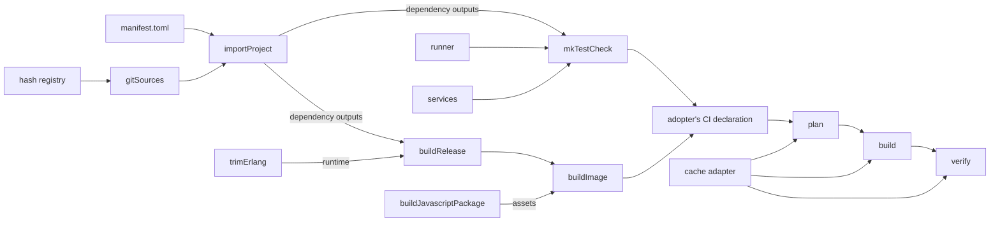

# Design

Gleam Nix builds each Gleam package as an independent Nix derivation. It reads the
resolved dependency graph from Gleam's manifest and preserves compiled package
outputs across consumers with identical inputs.

On that package graph it composes a test layer, a release and image layer, a
JavaScript entry point, and a CI layer. Each is a separate module: a plain value
or function whose defaults the caller can replace. None is tied to a cache
vendor or a test framework.

## Scope and terms

A **locked package** is a package entry in `manifest.toml`. A **package output**
contains one compiled OTP application and Gleam's compiler metadata. A
**project** combines a root Gleam package with its locked packages.

A **check** is one derivation that CI builds: one app or package tested, one
shard of one, or another check the adopter declares. A **runner** decides how a
check executes compiled tests. A **service** is a process a check needs while
its tests run, such as a database. A **derived check** is built from other
checks' outputs, such as coverage. A **cache adapter** is the value that tells
the CI layer how to read from and write to one binary cache. The **adopter** is
the repository that uses the library.

### Goals

The library serves Gleam repositories on Nix that want fast, trustworthy CI and
a shipped artifact they can trust:

- **In CI, only the checks whose inputs changed run.** A check is one app or
  package, or one shard of one. A run where no test input changed finishes in
  the time it takes to plan and verify.
- **What ships is what was tested.** The image is built from the dependency
  outputs and compiler the tests used ([D10](#d10-release-and-image)).
- **Adoption is small.** An adopter writes a short Nix declaration of its
  checks and at most one line of workflow. Every default sits behind a value
  the adopter can replace.

Two shapes exercise the interfaces together, so neither freezes them alone: a
single-service repository with a sharded PostgreSQL suite, and
[oversight](https://github.com/gleam-dream/oversight), a multi-app repository
whose apps share PostgreSQL and Git dependencies.

### No-goals

The library does not:

- resolve dependency versions, update manifests, or replace Gleam's development
  workflow;
- implement Rebar3, Mix or npm, which it delegates to Nixpkgs' builders;
- support languages other than Gleam, targets other than Erlang and JavaScript,
  or cross compilation;
- deploy. Deploys stay in each adopter or in its own adapter;
- ship cache backends beyond its shipped adapters, or choose one by default;
- balance shards by run time;
- use content-addressed derivations;
- run checks or build images on Darwin. Version 1 is Linux only; a Darwin user
  evaluates and develops locally;
- own an adopter's non-Gleam checks, such as scripts in other languages,
  documentation snippets or experiment playgrounds. They stay checks the
  adopter declares, or jobs of its own.

### Ownership

Nix owns immutable output storage, build scheduling, and binary-cache access.
The caller owns the Nixpkgs revision and toolchain selection. Gleam owns source
compilation and the compiler metadata format. The adopter owns which checks
exist, which cache adapter it uses and its credentials, its deploys, and the
name of its required check. The CI vendor owns job scheduling.

### Stability

The package layer ([D1](#d1-locked-graph) to [D6](#d6-composition)) and the
test layer are stable. The release and image layer and the JavaScript entry
point are **unstable**: they have one user, so they may change without a major
version until a second user adopts them. The CI layer contains no Gleam. It
carries its own compatibility version and its reusable workflow is tagged
separately, so a Gleam or toolchain change does not move an adopter's CI.

### Composition

## Public interfaces

`import ./default.nix { inherit pkgs; }` and `lib.mkLib pkgs` create the same
package scope. The scope supports `overrideScope`; changing `beamPackages`
selects a consistent Erlang/Elixir package set.

- `buildGleamPackage { pname; version; src; beamDeps ? []; includeDev ? false; ... }`
  compiles one package. Standard derivation attributes and build hooks remain
  available. It does not read a fetched source during evaluation.
  Use `override` to change builder arguments and `overrideAttrs` for ordinary
  derivation attributes and hooks.
- `importProject { src; manifest ? src + "/manifest.toml"; sourceOverrides ? {};
packageOverrides ? final: prev: {}; buildForeign ? false; foreignArgs ? {};
includeDev ? false; packageArgs ? {}; }`
  returns `package`, `packages`, `sources`, and the parsed `manifest`.
  The root source and manifest must be readable during evaluation.
  With `buildForeign`, a locked package that does not use Gleam builds with
  Nixpkgs' `buildRebar3` (preferred when offered) or `buildMix`, using its
  locked source, version, OTP application name and dependency edges.
  `foreignArgs.<name>` passes further arguments to that builder, such as
  `buildPlugins`, `nativeBuildInputs` or `patches`. The reserved arguments
  `name`, `version`, `src` and `beamDeps` cannot be replaced. An undeclared
  package name in `foreignArgs` fails evaluation.
  `packageArgs` customizes ordinary derivation attributes; it cannot replace
  the root identity, source, dependency graph, target, or development mode.
- `readManifest path` validates and returns the manifest's package entries.
- `fromBeamPackage { package; pname; version; otpAppName ? pname;
beamDeps ? package.beamDeps or []; appDir ? ...; }` attaches package metadata
  to an already compiled BEAM derivation. It does not rebuild that package.
- `gitSources { manifest; registry; }` turns the manifest's Git entries and a
  hash registry into `sourceOverrides` ([D2](#d2-sources)).

The test, release, JavaScript and CI modules extend the same scope. Their
interfaces live with their behavior: [test checks](#d7-test-checks),
[runners](#d8-runners), [services](#d9-services),
[release and image](#d10-release-and-image),
[JavaScript packages](#d11-javascript-packages), and
[CI commands](#d12-ci-commands) with [cache adapters](#d13-cache-adapters-and-trust).

A package output follows Nixpkgs' layout:
`lib/erlang/lib/<otp-application>-<version>/`. It retains `ebin`,
`_gleam_artefacts`, `include`, and `priv` when produced by Gleam.
`src/` retains the patched package source for consumers such as Mix.
Setup hooks and propagated dependency references live in `nix-support/`.
The output is a compiled library; executable launchers and deployment releases
belong to the caller. The example flake provides a development shell that loads
the library and its runtime dependencies through the setup hooks.

## Behavior and invariants

### D1: Locked graph

When importing a project, dependency edges come from locked package
`requirements`. Root edges come from `gleam.toml` dependency names.
Duplicate locked names, missing requirements of Gleam packages, and cycles fail
evaluation with a diagnostic naming the offending packages. The library does not
perform version resolution.

Hex records every declared requirement of an Erlang or Elixir package,
including optional ones that Gleam never locks (jason lists decimal). Packages
without the `gleam` build tool drop all edges to unlocked packages, regardless
of source type. The manifest does not identify which requirements are optional,
so this also drops missing required foreign dependencies. A stale or incomplete
foreign graph can therefore pass validation. A Gleam package keeps strict
validation, because its missing edge means a corrupt manifest.

### D2: Sources

Hex packages use their manifest version and outer checksum through
Nixpkgs' `fetchHex`. Local paths resolve relative to the root source.
`sourceOverrides` replaces a declared package source without changing its edges.
A Git or other unsupported source requires an explicit source override.
A source override for an undeclared package fails evaluation.

Fetching creates Nix fetcher derivations. The library never reads their output
to discover metadata during evaluation, so Hex builds do not require import
from derivation. The locked record supplies the package name and version.

`gitSources` is the supported way to supply Git sources. The adopter keeps a
registry of content hashes keyed by repository URL and locked commit, as pure
data. The helper takes the host, owner and repository from the manifest's URL,
supports packages in subdirectories, and fails evaluation naming any Git entry
the registry lacks. It produces ordinary `sourceOverrides`, so the rule above
still holds: nothing fetched is read during evaluation, and evaluation needs no
Git credentials.

### D3: Package compilation

A Gleam package compiles with `gleam compile-package`, the selected Erlang
toolchain, and previously compiled dependencies. It preserves compiler metadata
beside BEAM bytecode. Package outputs expose their direct `beamDeps`, OTP
application name, application directory, and Gleam compiler.
During compilation, the current package is discoverable under its OTP name so
Erlang FFI can use `include_lib` for its own generated record headers.

A package that ships Elixir sources next to its Gleam modules needs the Elixir
compiler on `PATH`. Supply the selected `beamPackages.elixir` through
`nativeBuildInputs`, or `packageArgs.nativeBuildInputs` for a project root.
Gleam runs `elixir` from the library
directory and writes there, so the build hands it a writable copy of the
dependency link farm instead of the read-only store path.

The compiler input does not retain or load Elixir's runtime for consumers.
The caller retains the selected `beamPackages.elixir` in its runtime environment
or through the package's `propagatedBuildInputs` (for a project root,
`packageArgs.propagatedBuildInputs`). A bare Erlang launcher adds
`${elixir}/lib/elixir/lib` to `ERL_LIBS` and starts the `elixir` application
before calling Elixir modules. Use the same BEAM package set as the build.

The selected compiler must support `--no-dev` and application-file generation
(Gleam 1.19 or newer). A Gleam dependency compiled with another compiler or Erlang
derivation fails evaluation. The root project must select the Erlang target.
An unsupported locked build tool fails with guidance to set `buildForeign` or
to provide a package override. `packageOverrides` still applies after
`buildForeign` and replaces any package it names.

### D4: Cache identity

Each dependency derivation depends on its own source, resolved compiled
dependencies, selected tools, and build options. It excludes the consuming
project's source, full manifest, and unrelated locked packages.
Equivalent dependencies across projects have equal derivation paths.
Dependency ordering does not affect the derivation path.
Changing application code changes the application derivation while leaving its
dependency derivations unchanged. Changing a dependency invalidates its consumers.
Local path inputs exclude `build`, `_build`, `node_modules`, and `.direnv`
directories only at the source root. Nested source namespaces and resources
with these names remain intact. Local inputs also use Nixpkgs' standard clean
source filter.
Prepared source objects and store-context strings are kept opaque during evaluation.

### D5: Development code

Dependency packages always compile without their development code and
development dependencies. Production root builds exclude root development
dependencies. With `includeDev = true`, only the root additionally compiles its
development/test modules and declares its development dependencies.

### D6: Composition

`beamDeps` retains dependency outputs in the Nix closure. A setup hook adds the
standard application directory to `ERL_LIBS`. Compiled Rebar3 and Mix packages
can enter the locked graph through `buildForeign`, or through
`packageOverrides` and `fromBeamPackage` for full control. They must use the
caller's selected BEAM package set.
Overrides replace the build method while preserving the locked name, version,
OTP application name, and resolved direct dependency edges.

Build-time Rebar3 plugins belong in `foreignArgs.<name>.buildPlugins` and must
come from the same BEAM package set. For example, esqlite's SQLite NIF needs
`foreignArgs.esqlite.buildPlugins = [ pkgs.beamPackages.pc ];` when using the
default scope. The [foreign-build recipe](../examples/foreign-builds.nix) supplies
this plugin before the sandbox build; Rebar3 cannot download it there.

The compiler library directory includes the transitive dependency closure.
Conflicting outputs or aliases with the same package name or OTP application
name fail evaluation, rather than depending on directory traversal order.
Multiple references to one physical output must agree on its compiler and
dependency metadata.
Builders and `fromBeamPackage` own that metadata declaration. Standalone callers
must reuse those canonical nodes; manually changing metadata fields on a
returned package is outside the supported API. Adapter metadata declares how
an output was built and does not inspect or prove its bytecode provenance.
The compiler receives explicit mappings when package and OTP application names
differ.

The package output stays a compiled library. Assembly beyond it is a separate
layer over the same outputs: a test check ([D7](#d7-test-checks)) and a release
([D10](#d10-release-and-image)) consume the project's dependency outputs as they
are, and neither rebuilds a dependency. An adopter can still assemble its own
launcher or OTP/Mix release from the package output instead.

JavaScript dependencies from npm, pnpm or Yarn belong to a separate derivation.
A Gleam frontend compiles through its own entry point,
`buildJavascriptPackage` ([D11](#d11-javascript-packages)), and `importProject`
keeps accepting only the Erlang target. The image consumes the frontend's
output as assets beside the compiled BEAM package.

### D7: Test checks

**Interface.** `mkTestCheck { project; inputs ? <default fileset>; runner ?
<default runner>; services ? []; vmFlags ? []; ... }` returns one check. The
check compiles the root with `includeDev` against the project's cached
dependency outputs, gates warnings, then hands the compiled tree to its runner.

**Invariants.**

- **One compile model.** Tests compile per package through this library, never
  in one `gleam build`. A test check's dependencies are the same derivations as
  the project's production dependencies, so they are built once and shared
  across checks, apps and repositories.
- **Explicit inputs.** A check's source is an explicit fileset. By default it is
  the app's directory plus the local paths its manifest names, minus build
  directories and agent documents such as `AGENTS.md` and `CLAUDE.md`. The
  adopter adds shared extras by name. An edit outside a check's inputs leaves
  that check cached.
- **Warnings are errors, in Gleam and Erlang alike.** Erlang sources compile
  with warnings as errors against the compiled dependencies. Gleam's package
  compiler has no such flag, so the Gleam half reads the compiler's output for
  the root package only, never for dependencies. That reading is a brittle
  surface, pinned by a fixture test, and Gleam is asked upstream for a flag.
- **Coverage is apart from execution.** The expected set of test modules comes
  from source discovery, never from what a runner reports. A coverage check
  derived from a project's checks compares the two and names each module that
  ran nowhere or ran twice.
- **Sandbox.** Every BEAM VM a check starts loads a CA bundle. A failing run
  leaves no output in the store; its log goes to the build log.
- **Supported compilers.** The test layer declares the Gleam versions it
  supports. Evaluation fails outside that range, so an untested compiler never
  runs a reproduction of its generated code.

**Verification.** Fixture projects in the library's checks show that an edit to
a test module rebuilds only the root check, that a Gleam or an Erlang warning in
the root fails the check while one in a dependency does not, and that coverage
names a missing and a duplicated module. A fixture pins the compiler output the
warnings gate reads, so a Gleam release that changes it breaks this library's
checks, not an adopter's.

### D8: Runners

**Interface.** A runner is a value a check takes. It receives the compiled tree
and the check's environment, runs tests, and reports each test module it ran
with its time. Two runners ship.

- The **default runner** runs the package's own test `main`, exactly as
  `gleam test` does.
- The **shard runner** runs one shard's modules, and takes a `setup` hook, a
  shard count and optional pins of a module to a shard.

**Invariants.**

- **Same entry contract as Gleam.** Both runners reproduce the `<app>@@main`
  module Gleam generates: binary UTF-8 on standard I/O, trapped exits, the
  application started, panics printed with their stack traces, and the exit
  status set. The layout of that module is a brittle surface with a fixture.
- **Local and CI agree.** The default runner calls `<package>_test.main()` from
  a copy of the root's source, because gleeunit discovers `test/` relative to
  the working directory. Setup an adopter does in its test `main` therefore
  runs in CI too. An eunit listener reports each module and its time, which
  gleeunit's own output does not name.
- **Sharding is a second runner, not a mode.** The shard runner runs a shard's
  modules through eunit with gleeunit's options, which it copies; those options
  are a brittle surface with a fixture, and gleeunit is asked upstream for an
  entry point that takes a module list. Setup moves into the `setup` hook.
- **Stable membership.** A module's shard follows from a hash of its name,
  unless the adopter pins it. Adding a module moves no other module. All shards
  of one check share one compile derivation.
- **Declared contract.** A runner reads its shard and writes its module report
  as declared files, never by scraping a test log.

**Verification.** One fixture whose test `main` does setup runs under both
runners, with the shard runner's `setup` hook doing the same work, and both
report the same modules with the same verdicts. A fixture with a panicking
test shows the stack trace and a failing exit status under each runner.

### D9: Services

**Interface.** A service is a value `{ start; stop; env; }`. It takes an init
hook (for example roles and databases), environment aliases, and a package
parameter. A check takes a list of services. PostgreSQL ships first, built on
Nixpkgs' `postgresqlTestHook` where that fits, with the PostgreSQL package
chosen by the adopter.

**Invariants.**

- **Isolated.** Each service gets its own state directory and a fresh port per
  run of a check, so every shard has its own services.
- **Composable.** Services' environments merge into the check's. A clash
  between variable names, among services or with the check's own environment,
  fails evaluation. The check runs on names, because values such as ports exist
  only at run time.
- **Adopter-shaped.** Aliases let one service serve different conventions,
  such as a single connection URL in one repository and a named role with its
  own databases in another.
- **Diagnosable.** When a check fails, each service's log is printed to the
  build log before the service stops.

**Verification.** The library's checks start PostgreSQL at two major versions,
one with an init hook creating a non-superuser role and its databases, one
exporting a connection URL through an alias. A fixture with two services
declaring the same variable fails evaluation naming both. A failing test shows
the service log in the build log.

### D10: Release and image

This layer is unstable ([Stability](#stability)). It is extracted from an
existing image build of one adopter.

**Tested equals shipped.** The image holds the tests' dependency outputs and
compiler. The root is compiled twice from the same source: once with
development code for tests, once without for the release. The runtime is a
checked derivative of the Erlang the tests ran on.

**Interface.**

- `trimErlang { without; }` copies the cached Erlang and removes the listed OTP
  applications.
- `buildRelease { project; runtime; }` assembles a release from the project's
  dependency outputs and a production compile of the root, on the given
  runtime.
- `buildImage { release; name; port; health; user; assets ? null; }` builds an
  OCI image with Nixpkgs' `dockerTools`.

**Invariants.** Each assertion lives in the step that can break it.

- **`trimErlang`.** The image's Erlang is trimmed by copying, never rebuilt.
  Binaries embed their store paths, so the copy keeps a store name of the same
  length as the original, or it shows that no binary embeds the original.
- **`buildRelease`.** The production compile passes the same warnings gate as
  the tests. References to the original Erlang are rewritten to the runtime.
  No application in the service's `.app` dependency closure needs a removed
  application, and no development module ships.
- **`buildImage`.** The image carries a runtime contract: a non-root user, CA
  certificates, a shell and an HTTP client for the health check, and an
  entrypoint. Its closure, binaries included, holds no untrimmed Erlang.

**Verification.** A fixture release that depends on a removed application
fails `buildRelease`. The image check scans the closure, binaries included, for
the original Erlang path. A boot-and-health check starts the image and waits
for its health endpoint.

### D11: JavaScript packages

This entry point is unstable ([Stability](#stability)).

**Interface.** `buildJavascriptPackage { src; ... }` builds a Gleam project for
the JavaScript target and runs its tests with Node. Its npm dependencies come
from a separate npm derivation ([D6](#d6-composition)). Its output can be an
image's `assets`.

**Invariants.** It is a separate entry point: `importProject` keeps its
Erlang-only guard, and nothing in the Erlang graph depends on the frontend. A
frontend edit rebuilds the frontend and the image, never the backend.

**Verification.** A fixture frontend builds and its tests pass under Node, and
an image built with it as `assets` serves them.

### D12: CI commands

**Interface.** The CI layer is three vendor-neutral commands over the adopter's
CI declaration, a per-system flake output alongside `checks`. The declaration
lists the checks to plan, the checks that always run, the derived checks, and
the external jobs that planning gates.

- `plan` evaluates the declared checks, asks the cache adapter which are
  missing, and emits stages, so a shared compile builds once before its shards.
  It reports why each check missed.
- `build` builds one check and pushes its closure through the adapter.
- `verify` substitutes every declared check with local builds forbidden, then
  builds the derived checks locally from them.

An optional reusable workflow runs `plan`, then each stage, then `verify`, and
publishes the image from `main` through a command the adopter supplies. It
takes adapters and checks by name, because a reusable workflow accepts only
strings and secrets. An adopter can compose the commands in its own workflow
instead.

**Invariants.**

- **Cache status is asked, never parsed.** `plan` reuses an existing
  evaluator's cache-status query instead of parsing build output, and its time
  is a small, measured part of a run where nothing changed.
- **One verdict.** `verify` is the only check that decides a run. It names any
  missing check and the job that should have pushed it, reasoning from the
  adapter's declared scope ([D13](#d13-cache-adapters-and-trust)), so a skipped
  job never counts as a pass.
- **The adopter's name.** The required check keeps the name the adopter
  chooses.
- **External jobs.** A job outside the library, which `plan` gates, marks
  itself done by convention under the trust rule, not by evidence. The design
  says so rather than hide it.
- **Observable.** Each run reports why each check missed, push failures as a
  count, and the time per check and per module.
- **Only the gap.** The commands build only what existing tools leave, such as
  turning checks into a matrix or skipping cached builds. What that gap is gets
  settled before the commands are written.

**Verification.** A fixture declaration with a compile shared by two shards
plans them in two stages. `verify` against a cache missing one check fails
naming that check and its job. The cache-status query of the evaluator is a
brittle surface with a fixture.

### D13: Cache adapters and trust

**Interface.** A cache adapter is a value: a substituter, a push command, a
query, and `setup` and `teardown` run in each `plan`, `build` and `verify` job.
Each adapter declares who can read and who can write its entries, globally or
per ref. The library ships adapters for the GitHub Actions cache, Cachix and
Attic, and a store local to the run, carried between jobs as workflow
artifacts. It ships no default; the adopter chooses. An adopter's private
adapter lives outside this repository and has the same shape.

**Declared scopes.**

| Adapter              | Who reads                                                                       | Who writes                                                                                                   |
| -------------------- | ------------------------------------------------------------------------------- | ------------------------------------------------------------------------------------------------------------ |
| GitHub Actions cache | A run reads its own ref, then the default branch; a pull request reads its base | Each run writes its own ref; a pull request's entries are readable by that pull request only, forks included |
| Cachix               | Anyone the cache admits; public caches need no secret                           | A holder of the cache's write token                                                                          |
| Attic                | Anyone the cache admits                                                         | A holder of a token with push rights on the cache                                                            |
| Run-local store      | Jobs of the same workflow run                                                   | Jobs of the same workflow run                                                                                |

`plan`, `verify` and the documentation reason from this table, not from
assumptions. Under the GitHub Actions cache, for example, a merge to `main` is
not a cache hit: `main` rebuilds what each pull request built, while pull
requests reuse `main`'s entries and their own.

**The trust rule.** A store path names the recipe, not the result. Write
access to a cache namespace is therefore merge rights on every repository that
reads from it, for every path shared across those repositories, toolchains
and dependency outputs included.

**Invariants.**

- **Shared by default.** Every run that holds a write credential pushes, pull
  requests included. An adopter can turn off pushes from pull requests.
- **Degraded, not broken.** A run that can't push, such as a fork's pull request
  under an adapter that needs a secret, or a run whose cache is unreachable,
  uses the run-local store. `verify` keeps one code path, and the run is
  reported as degraded.
- **Duties the adopter owes.** Under the trust rule, the image records what
  tested it, a scheduled check ends the trust if the repository ever requires an
  approving review, and a rebuild without the cache is the recovery.

**Verification.** Each adapter's declared scope is exercised: a fork's pull
request reaches `verify` through the run-local store, an unreachable cache
reports a degraded run, and the merge-hit behavior of each shipped adapter is
recorded. The tool behind the GitHub Actions adapter is a brittle surface with
a fixture.

## Implementation boundaries

`lib/manifest.nix` owns graph validation. `lib/import-project.nix` owns source
selection and graph construction. `lib/build-package.nix` owns compilation and
the BEAM output contract. `lib/clean-source.nix` owns local source filtering for
Gleam and delegated foreign builds. `lib/beam.nix` owns dependency closure and
compatibility checks. `lib/default.nix` binds these functions to the caller's
package set.

Each new module owns one concern and depends only on the package layer's
public interface: Git sources, test checks with their runners, services, the
release and image, and the JavaScript entry point. The CI layer sits apart from
the Gleam scope. It reads only the adopter's CI declaration and the cache
adapters, and it carries its own compatibility version.

## Research and decisions

The implementation takes the package graph approach from
[crate2nix](https://github.com/nix-community/crate2nix), which builds individual
crates. It uses the input-isolation principle illustrated by
[Crane's dependency builds](https://crane.dev/API.html#cranelibbuilddepsonly):
application source changes must not invalidate dependency compilation.

[deps_nix](https://github.com/code-supply/deps_nix) demonstrates compiled Mix
dependencies as separate derivations. Reusing
[Nixpkgs' BEAM builders](https://github.com/NixOS/nixpkgs/tree/master/pkgs/development/beam-modules)
keeps native compilation, Mix configuration, and Rebar3 plugins with their
existing owners.

[Nixpkgs' JavaScript support](https://nixos.org/manual/nixpkgs/unstable/#javascript-buildNpmPackage)
provides a separate frontend dependency graph. Asset assembly can depend on its
output without coupling npm inputs to every Gleam dependency.

[Gleam's compilation API](https://gleam.run/documentation/command-line-reference/#compile-package)
accepts already compiled dependencies from the same compiler version. This
provides the package boundary without a compiler fork.

The test, image and CI layers generalise two existing setups. A single-service
repository with a sharded PostgreSQL suite cut its required check from many
minutes to about a minute and a half when no test input changed, with cached Nix test derivations, sharding, and plan, build and verify
jobs, but it compiled in one `gleam build`, found shards by reading test logs,
called gleeunit's private functions, and repeated one cache vendor's steps in
every job. A multi-app repository ran every app's tests on every push, in the
development shell, with nothing cached. The modules keep the first setup's
reuse and the second's per-app independence, without either's hand-written
plumbing.

[nix-github-actions](https://github.com/nix-community/nix-github-actions)
turns flake checks into a job matrix, and
[nix-fast-build](https://github.com/Mic92/nix-fast-build) and
[omnix](https://omnix.page/om/ci.html) skip what is already cached.
[nix-eval-jobs](https://github.com/nix-community/nix-eval-jobs) reports cache
status per job. The CI layer builds on them and writes only the gap they leave.
[GitHub's cache documentation](https://docs.github.com/en/actions/reference/workflows-and-actions/dependency-caching)
defines the per-ref scope that the GitHub Actions adapter declares.

### Rejected alternatives

- **One `gleam build` per check.** Dependencies would recompile in every check,
  nothing would be shared across apps or repositories, and it depends on
  Gleam's internal build files.
- **Shipping the exact tested compile.** It would carry test and development
  modules and need a strip step with its own proof. The root is compiled twice
  instead, under the same warnings gate.
- **One eunit runner with a setup hook for every adopter.** Setup in a test
  `main` would move into Nix, and local `gleam test` and CI would run different
  entry points. The default runner runs the package's own `main`.
- **Reading Git sources with an evaluation-time fetch.** It breaks D2's rule,
  puts a fetch in every plan job, and needs Git credentials there.
- **A new repository for the test, image or CI layers.** One home, with
  separate modules and a separate compatibility version for CI, keeps the
  interfaces in step with the package layer.
- **A reusable workflow with a private action injected by the caller.**
  Reusable workflows accept only strings and secrets.
- **Per-stage composite actions as the main interface.** Every adopter would
  keep a long workflow. They remain one way to compose the commands.
- **Pull request runs never push by default.** It leaves `verify` without a
  channel for results, and it discards the reuse that makes Nix worth having.
  The trust boundary is the write credential, and the trust rule says so.
- **Workflow artifacts as the main channel.** Every push to a pull request
  would rebuild from `main`. They are kept as the run-local adapter for runs
  that can't push.
- **A default cache backend.** Each backend's read and write scope differs
  enough to change what a merge reuses, so the adopter chooses.
- **Deferring the image and JavaScript layers to a second user.** The image is
  the point for a service, and an image build already exists to extract. The
  risk of freezing around one user is accepted and marked unstable.
- **Running a check's tests concurrently in one VM against separate
  databases.** Test harnesses assume one database per VM; shards get their own
  VM and services instead.

### Open questions

- **Which tool backs the GitHub Actions adapter.** A substituter that caches
  within one workflow of one repository, or a store snapshot saved and restored
  per job. A spike decides it, measuring query counts, throttling, bytes stored
  against the repository's cache allowance, and whether a fork's entries behave
  as documented.
- **Which gap existing CI tools leave.** Settled before the CI commands are
  written; the likely gap is `verify`, its diagnostics, and stages.
- **Whether hash sharding is fast enough.** Time per module, recorded from the
  first adoption, tells. The fallback is the shard count or pinning a module.
